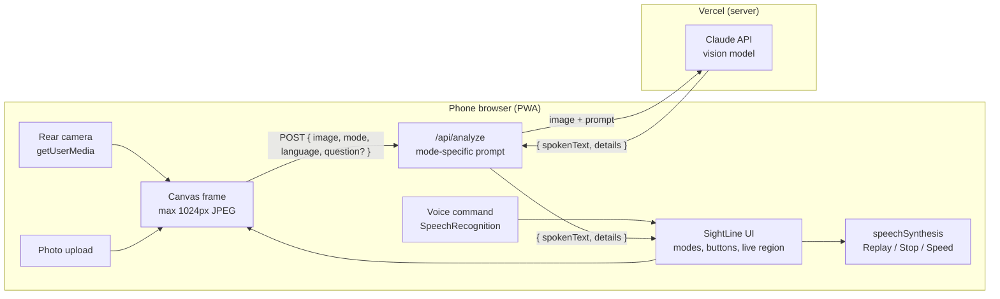

# SightLine

**Point your camera. Hear the world.**

SightLine is a mobile-first web app (installable as a PWA) that helps blind and low-vision people understand what's in front of them. Point your phone at something, tap one big button or say a voice command, and SightLine reads text aloud, describes the scene, explains a menu or medicine label, or translates a sign.

<!-- TODO: add screenshots / a GIF of the app here -->
_Screenshots coming soon._

## The problem

At least 2.2 billion people worldwide have a near or distance vision impairment, according to the World Health Organization ([WHO fact sheet: Blindness and vision impairment](https://www.who.int/news-room/fact-sheets/detail/blindness-and-visual-impairment)).
<!-- TODO: confirm this figure against the current WHO fact sheet before presenting, and add a stat closer to our users if we have one. -->

Everyday printed information (menus, medicine labels, street signs, mail) still assumes you can see it. Existing tools often need a dedicated app install, a specific phone, or a human volunteer on call. SightLine runs in any modern mobile browser and answers in a few seconds.

## Features

| Mode | What it does |
| --- | --- |
| **Read** | Reads all visible text aloud in natural reading order. |
| **Describe** | Two or three sentences about the scene, most important first: people, obstacles, signs. |
| **Menu / Label** | Summarizes a menu, product, or medicine label: name, key info, prices, warnings, allergens. |
| **Translate** | Reads the text and translates it into your chosen language, spoken by a voice for that language. |

- **One big Capture button**, plus **photo upload** as a fallback (handy on laptops).
- **Spoken results** with Replay, Stop, and speed control from 0.75× to 1.5×.
- **Ask about this**: ask a follow-up question about the same photo ("How much is the salmon?") by voice or by typing.
- **Voice commands**: "read this", "describe", "what's on the menu", "translate to Spanish", "repeat", "stop", "help".
- **Non-visual feedback**: a beep and a vibration when a capture starts, two rising beeps when the answer is ready, low beeps on errors. The app says "Looking" while it works.
- **Installable**: add it to your home screen; it opens full screen like a native app.

## Tech stack

- [Next.js](https://nextjs.org/) (App Router) + TypeScript + Tailwind CSS
- Anthropic Claude (vision) via the official [`@anthropic-ai/sdk`](https://github.com/anthropics/anthropic-sdk-typescript), called only from a server route so the API key never reaches the browser
- Browser Web Speech API: `speechSynthesis` for speech output, `SpeechRecognition` for voice commands (where supported)
- `getUserMedia` for the rear camera; frames are downscaled to 1024 px JPEG before upload
- Deployed on [Vercel](https://vercel.com/)

## Architecture



The last photo stays in memory on the phone so follow-up questions can be asked about it. Nothing is stored on the server.

## Run it locally

Requires Node.js 20 or newer and an Anthropic API key ([console.anthropic.com](https://console.anthropic.com/)).

```bash
npm install
cp .env.example .env.local   # then put your key in ANTHROPIC_API_KEY
npm run dev
```

Open http://localhost:3000. Browsers only allow the camera on `localhost` or HTTPS, so to test on a phone either deploy to Vercel or use a tunnel such as `npx localtunnel --port 3000`.

### Environment variables

| Variable | Required | Default | Notes |
| --- | --- | --- | --- |
| `ANTHROPIC_API_KEY` | Yes | | Server-side only. Never commit it. |
| `ANTHROPIC_MODEL` | No | `claude-opus-5-5` | Any vision-capable Claude model. |

## Deploy to Vercel

1. Push this repo to GitHub (already done if you're reading this there).
2. In Vercel, choose **Add New → Project** and import the repo. The Next.js preset is detected automatically.
3. Under **Environment Variables**, add `ANTHROPIC_API_KEY` (and optionally `ANTHROPIC_MODEL`).
4. Click **Deploy**. Open the URL on your phone and choose **Add to Home Screen**.

Or from the command line: `npx vercel`, then `npx vercel env add ANTHROPIC_API_KEY`, then `npx vercel --prod`.

## Accessibility

Accessibility is the product, so it was designed in from the start:

- **Screen readers**: every control has a text label; mode and speed buttons expose `aria-pressed`; results are announced through an `aria-live="polite"` region; the decorative camera preview is hidden from assistive tech; landmarks (`header`, `nav`, `main`, labelled sections) give a logical order.
- **VoiceOver / TalkBack users**: turn **Auto-speak off** so the app doesn't talk over your screen reader; results are still announced through the live region.
- **Large targets**: every control is at least 64 × 64 px; Capture is the largest element on screen and is always visible.
- **Contrast**: dark theme by default. White on black (21:1) and yellow `#FFD60A` on black (about 14:1) both meet WCAG AAA. Base text size is 18 px and pinch zoom stays enabled.
- **Never color alone**: the selected mode shows a check mark and a thicker border as well as a color change; errors start with the word "Error".
- **Feedback beyond sight**: spoken status, beeps, and vibration (`navigator.vibrate`, where supported; iOS Safari does not support it).
- **Motion**: the loading spinner only animates when `prefers-reduced-motion` is not set.
- **Checked with axe-core** (WCAG 2.2 A, AA, AAA and best-practice rules): 0 violations.
  <!-- TODO: also run a quick manual pass with VoiceOver (iOS) and TalkBack (Android) before the demo. -->

## Team

<!-- TODO: add names, roles, and links -->
- TODO: Name, role
- TODO: Name, role

## What's next

- **Offline mode**: on-device text recognition for Read mode when there's no signal.
- **Navigation and obstacle detection**: continuous mode that warns about steps, poles, and traffic while walking.
- **Wearable glasses**: hands-free capture from smart glasses with audio through bone-conduction speakers.
- Currency recognition, color identification, and saving favorite places' menus.

## License

[MIT](LICENSE)
