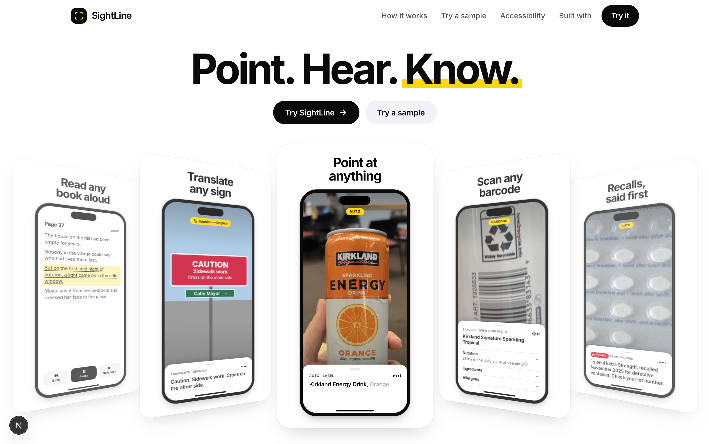
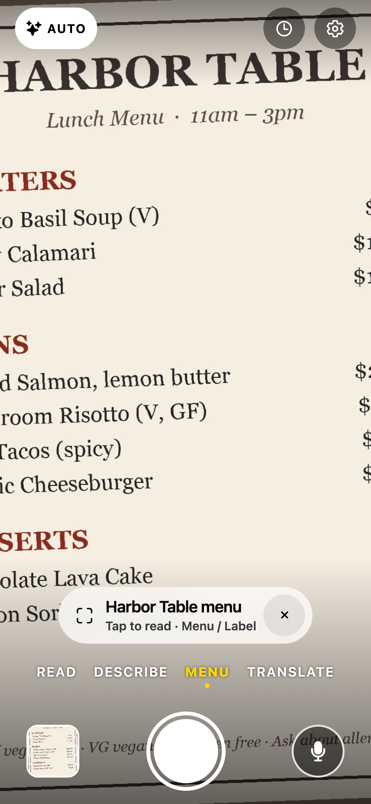
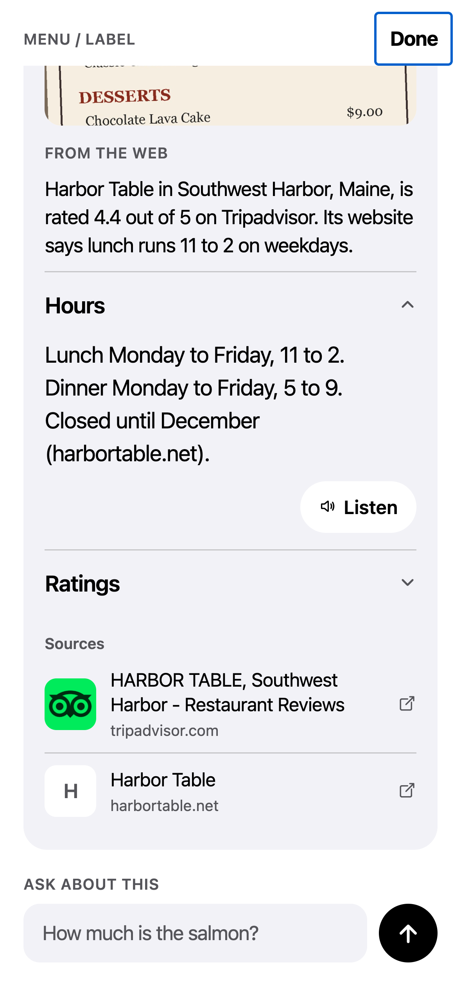
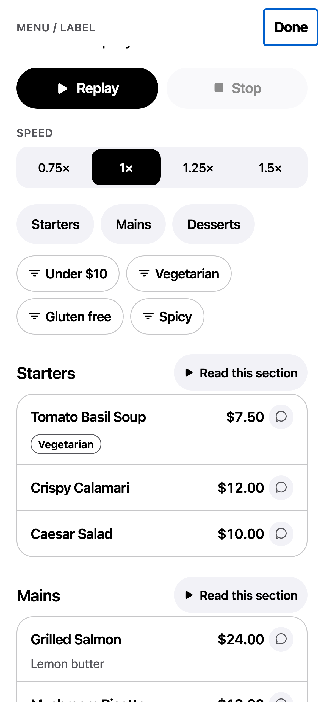
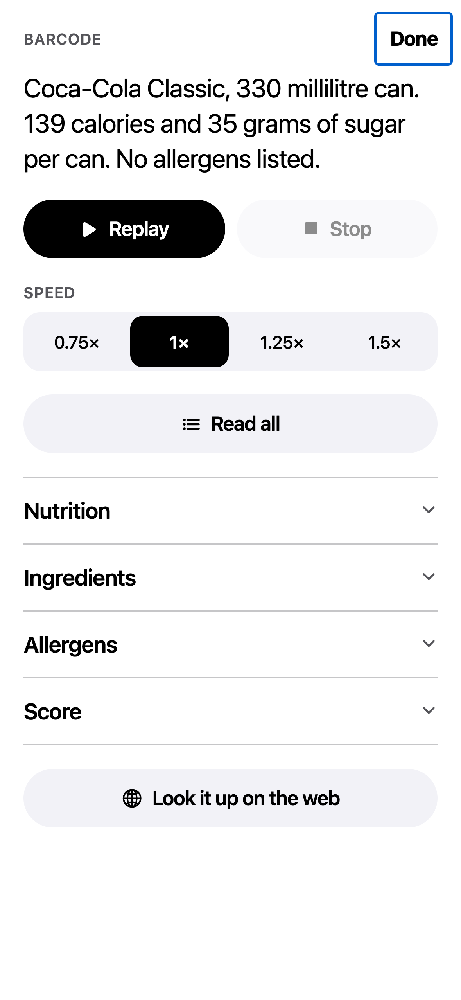
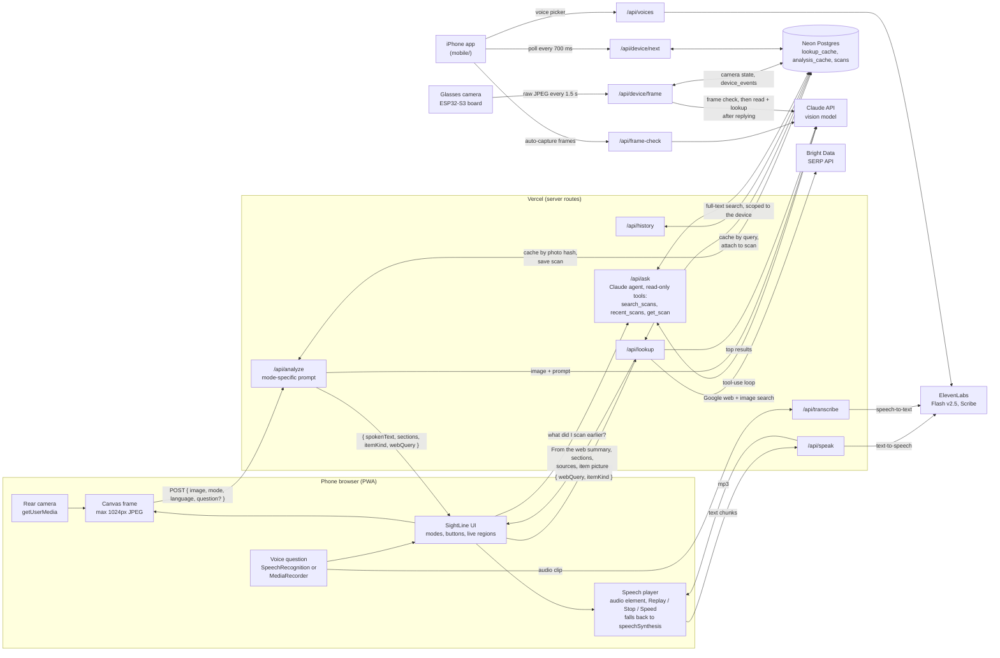

# SightLine

**Point your camera. Hear the world.**

SightLine is an AI copilot for blind and low-vision people, and for anyone who can't read what's in front of them. Point a phone, or a small camera on your glasses, at a menu, a can, a medicine box or a sign, and SightLine tells you what matters, out loud.

- **Live site:** https://sightline.study (also at https://sightline-theta-drab.vercel.app)
- **Web app:** https://sightline.study/app, in any phone browser, with nothing to install
- **iPhone app:** [mobile/](mobile/README.md) (React Native, runs in Expo Go)
- **Glasses camera:** [hardware/](hardware/xiao-cam/README.md) (ESP32-S3 camera board)

Built at SanD Hacks Fall 2026, UC San Diego.



<p>
  
  
  
  
</p>

## The problem

At least 2.2 billion people worldwide have a near or distance vision impairment, according to the World Health Organization ([WHO fact sheet: Blindness and vision impairment](https://www.who.int/news-room/fact-sheets/detail/blindness-and-visual-impairment)).

Everyday printed information (menus, medicine labels, street signs, mail) still assumes you can see it, and that you can read the local language. A traveler in a foreign city faces the same wall of unreadable signs and menus that a low-vision person faces every day.

Existing tools often describe instead of answer ("a blue package on a table"), need a dedicated app or a specific phone, or depend on a human volunteer picking up.

## The solution

SightLine gives the answer a sighted friend would give: the name, the dose, the allergens and the price, said first and out loud, in a few seconds. The details are one tap away, and you can ask about them.

It's built for two kinds of people:

- **Can't see it?** Blind and low-vision people get text and objects read and described out loud.
- **Can't read it?** People with dyslexia, and travelers facing another language, hear a sign, menu or letter read in their own language.

### Modes

| Mode | What it does |
| --- | --- |
| **Auto** (default) | Works out whether you're showing it a menu, a label, a sign or a room, and answers the right way. |
| **Read** | Reads the text on the item you're showing, in natural reading order. |
| **Describe** | Two or three sentences, most important first: the item you're holding, or the people, obstacles and signs in a scene. |
| **Menu / Label** | Summarizes a menu, product or medicine label: name, key info, prices, warnings, allergens. |
| **Translate** | Reads the text and translates it into your language, spoken by a voice for that language (13 languages). |

### Features

- **Detect**: hold the camera steady on something and a card names it ("Lunch menu · Tap to read"). Tracking brackets show what SightLine has locked on to. Nothing is read until you tap.
- **Barcodes**: SightLine spots a barcode on its own and reads the exact product from Open Food Facts and openFDA: nutrition, ingredients, allergens and any recall.
- **Menu view**: a menu comes back as sections, filters (Under $10, Vegetarian, Gluten free, Spicy) and one row per dish. Tap a dish to hear it, or ask about it.
- **Web lookup with Bright Data**: when the photo shows a specific product, medicine, restaurant, book or place, SightLine searches Google through Bright Data's SERP API and speaks a short "From the web" summary after the first answer, with sources on screen. A recall or FDA safety warning always comes first. The first answer never waits for the web.
- **Natural voice from ElevenLabs**: answers are spoken by an ElevenLabs voice you choose (Flash v2.5, multilingual). If ElevenLabs isn't set up, a request fails, or the phone is offline, SightLine switches to the phone's built-in voice without stopping.
- **Ask about this**: hold the mic and ask a follow-up about the same photo ("How much is the salmon?"), or type it.
- **Ask your history**: ask "What were the allergens on the cookies I scanned earlier?" or "Was that medicine recalled?" A Claude agent searches your past scans in Neon and gives a short spoken answer, usually in 2 to 3 seconds.
- **Instant repeats with Neon**: answers and web lookups are cached in Neon Postgres for 24 hours. A repeat comes back in about 150 ms instead of several seconds. Photos are never stored, only the answer text and web image links.
- **Glasses camera**: a small ESP32-S3 camera board on a pair of glasses sends a photo about every 1.5 seconds. When the same readable target shows up in two frames in a row, or the wearer presses the board's button, the server reads it and looks it up, and the paired phone speaks the answer. (The code and older docs call this the "hat" camera, from the first mount we planned.)
- **Book mode** (iPhone app): reads a printed page sentence by sentence, highlights where it is, and tells you when to turn the page.
- **Zoom and magnifier**: 1×, 2× and 5× chips or pinch to zoom on small print, and a magnifier for the photo in an answer.
- **Spoken results** with Replay, Stop, and speed control from 0.75× to 1.5×.
- **Non-visual feedback**: sounds and vibration when a capture starts, when the answer is ready, and on errors.
- **Installable**: add the web app to your home screen and it opens full screen like a native app.

## Challenges

**Getting the camera to focus on the one thing that matters.** A camera sees everything: the shelf behind the can, the poster behind the menu, the hand, the table. Our first answers described the whole view, or read text from the background. This was the hardest problem we worked on, and it's the one we're still tuning, most of all on the glasses, where the camera sees far more than the thing you're looking at. What we did about it:

- Every mode's prompt first decides what the user is pointing at (something held in a hand, close to the camera, or centered and filling a good part of the frame), answers only about that item, and ignores the signs, shelves, price tags and screens around or behind it.
- If several similar items are in view and none is clearly in front, SightLine says how many there are, answers about the one in the center, and asks you to hold up the one you want.
- A fast frame check runs before anything is read. It only counts a text-bearing item that is being presented to the camera, and never a keyboard, a monitor, furniture or a room.
- The glasses read only when the same target shows up in two frames in a row, so a glance across a room doesn't trigger a reading.
- Tracking brackets and zoom show what SightLine has locked on to, and it tells you when part of the item is cut off or covered by a finger, and how to fix it.

**Other problems we hit and fixed:**

- **Speed.** A spoken answer that takes 8 seconds feels broken. Claude Haiku 5.5 with thinking off was the fastest model that still read text accurately (about 2.5 seconds a photo). Repeats are cached in Neon, and the first answer never waits for the web lookup.
- **Text that reads well can sound wrong.** "6.50 dollars" was split into "six." and "fifty dollars", and "12 FL OZ" was read as letters. We wrote a layer that rewrites prices, units and numbers before anything is spoken.
- **Knowing when not to answer.** On a medicine label a confident guess is worse than no answer. SightLine says "I can't read that" on blurry print instead of guessing. We also caught a product database that turned a single can into a 12-pack.
- **Auto-capture.** Grabbing frames in the background made the screen flash black and produced dark photos. We fixed the capture, and decided Auto should offer a card and never read by itself.
- **Late answers.** A slow answer could start talking after you had moved on. Closing a result now stops all speech, and late answers for it stay silent.
- **A camera with no memory.** Serverless routes forget everything between requests, so what the glasses saw last frame and what they already read lives in Neon, with an atomic claim so the same label is never read twice.
- **Venue Wi-Fi.** The campus network blocks phone-to-laptop traffic, so the phone and the glasses couldn't reach a laptop server. We moved everything to the live Vercel site.
- **iOS Safari.** Audio has to be unlocked by a tap, and a home-screen web app has no speech recognition, so SightLine records the question and transcribes it with ElevenLabs Scribe.
- **Two people, one main branch.** A change that merged cleanly still broke the type check and the production deploy. After that we built the merged result before every merge.

## Tech stack

- **Claude** (vision) via the official [`@anthropic-ai/sdk`](https://github.com/anthropics/anthropic-sdk-typescript), called only from server routes so the API key never reaches the client. Claude Haiku 5.5 reads photos, writes the web summaries, checks camera frames and runs the history agent, all with structured JSON output.
- **[ElevenLabs](https://elevenlabs.io/docs)** text-to-speech (`eleven_flash_v2_5`) for spoken answers, and Scribe speech-to-text for voice questions.
- **[Bright Data SERP API](https://docs.brightdata.com/scraping-automation/serp-api)** for Google results as JSON. Claude then turns the results into a short spoken summary.
- **[Neon](https://neon.tech/)** serverless Postgres through `@neondatabase/serverless` (HTTP driver): the lookup cache, the analysis cache, per-device scan history, the glasses camera's state, and the memory behind "Ask your history" (Postgres full-text search). Everything still works without it.
- **Open Food Facts and openFDA** for barcode lookups and recalls.
- **[Next.js](https://nextjs.org/) 16** (App Router), React 19, TypeScript and Tailwind CSS for the website, the web app and every API route, deployed on **[Vercel](https://vercel.com/)**.
- **React Native with Expo** for the iPhone app, which uses the same API routes.
- **ESP32-S3 camera board** programmed with Arduino for the glasses camera.
- Browser APIs: `getUserMedia` for the rear camera (frames are downscaled to 1024 px JPEG before upload), `BarcodeDetector`, and the Web Speech API as the voice fallback.
- **Vitest**: 459 tests.

## Architecture



The last photo stays in memory on the phone so follow-up questions can be asked about it. Photos are never stored on the server. With Neon set up, the server keeps the text of answers (for caching and the device's own history) and web image links, and nothing else.

How the pieces fit together:

- **Answers**: `spokenText` is only the gist (about 30 words; in Read mode, the text itself). Recalls, warnings and allergens are always kept. Everything else comes back as `sections` with titles that fit the item, such as Nutrition, Ingredients and Allergens for a snack, Directions and Warnings for a medicine, or the menu's own headings.
- **Neon caches and history**: `/api/analyze` hashes the photo bytes together with the mode, language, question, model and prompt version (sha256), and answers repeats from `analysis_cache`. `/api/lookup` keys `lookup_cache` on the normalized query, item kind and language. Both caches last 24 hours. When a client sends an `x-sightline-device` header (a random ID it keeps), each answer is saved to `scans`, and `/api/analyze` returns a `scanId`. The web lookup is attached to that same scan when it finishes. Database writes happen after the response is sent, and a database read never holds up an answer for more than 1.5 seconds. If `DATABASE_URL` is missing or Neon fails, SightLine logs once and carries on without it.
- **Ask your history (agent memory)**: `/api/ask` runs Claude Haiku 5.5 in a tool-use loop of up to 5 turns. Before the first turn, the server runs a ranked full-text search on the question (a generated `tsvector` column on `scans` with a GIN index, weighting title, answer, sections and web summary) and fetches the 8 latest scans, in parallel. Most questions are answered in one turn from that. When they aren't, Claude calls `search_scans`, `recent_scans` or `get_scan`. Each tool runs a fixed, parameterized query limited to the caller's device ID, and Claude never writes SQL. The answer lists the scans it used, but only ones the tools actually returned.
- **Glasses camera**: `POST /api/device/frame` takes a raw JPEG with `x-device-id` and `x-device-key` (checked in constant time against `DEVICE_SHARED_KEY`). It runs the frame check and replies at once. Per-camera state in Neon (`device_state`) counts how many frames in a row showed the same ready target (confidence 0.7 or higher). It reads on the second such frame, or on `x-device-button: 1`, after replying. An atomic claim stops the same target being read twice within 2 minutes. Detections, framing hints (at most one every 5 seconds), answers and web lookups go to `device_events`. The phone polls `GET /api/device/next?device=&pair=&after=` with its `x-sightline-device` header. The pair code is an 8-character HMAC of the camera's ID with the shared key (`npm run device:code -- hat-01`). The first good poll pairs the camera with the phone (`device_pairs`), so its scans go into that phone's history.
- **Auto-capture** (iPhone app): `/api/frame-check` takes a small frame and answers whether a readable target is fully in view, with a stable key for it and a short framing tip ("Move back a little", "Too dark"). It takes about 1.2 seconds per frame.
- **Speech**: the client splits each answer into sentence-sized chunks of about 300 characters and plays them in order. The next chunk is fetched while the current one plays, so speech starts fast and long text never hits a request limit. Clips are cached for Replay and speed changes, and speed uses the audio element's `playbackRate`. The first tap unlocks audio for iOS Safari.
- **Web lookup**: `/api/analyze` returns an `itemKind` (food or drink, product, medicine, restaurant, book, place, or none) and a short `webQuery`. If there is something to search for, the client calls `/api/lookup`, which searches Google through Bright Data, asks Claude for a short spoken summary (about 35 words, in the Translate language when in Translate mode) plus sections, and returns them with the sources and a picture of the item from Google Images. A lookup is capped at about 15 seconds. If Bright Data is slow, a backup search with a slightly broader query starts after 3.5 seconds. A lookup that fails or times out says so in one short sentence.

## Run it locally

Requires Node.js 20 or newer and an Anthropic API key ([console.anthropic.com](https://console.anthropic.com/)). ElevenLabs and Bright Data keys are optional. Without them, SightLine uses the browser's voice and skips the web lookup.

```bash
npm install
cp .env.example .env.local   # then put your key in ANTHROPIC_API_KEY
npm run dev
```

Open http://localhost:3000. Browsers only allow the camera on `localhost` or HTTPS, so to test on a phone either deploy to Vercel or use a tunnel such as `npx localtunnel --port 3000`.

The iPhone app has its own steps in [mobile/README.md](mobile/README.md), and the glasses camera in [hardware/xiao-cam/README.md](hardware/xiao-cam/README.md).

### Environment variables

| Variable | Required | Default | Notes |
| --- | --- | --- | --- |
| `ANTHROPIC_API_KEY` | Yes | | Server-side only. Never commit it. |
| `ANTHROPIC_MODEL` | No | `claude-haiku-5-5` | Model for reading photos. Haiku 5.5 with thinking off was the fastest model that still read text accurately in our tests (about 2.5 s per photo, against 3.5 s for Opus 5.5). |
| `ANTHROPIC_FAST_MODEL` | No | `claude-haiku-5-5` | Model for web-lookup summaries and auto-capture frame checks. |
| `ELEVENLABS_API_KEY` | No | | Turns on ElevenLabs voices and Scribe voice input. The key needs Text to Speech and Speech to Text access. Without it, SightLine uses the browser's voice. |
| `ELEVENLABS_VOICE_ID` | No | `XrExE9yKIg1WjnnlVkGX` ("Matilda") | Any voice ID from your ElevenLabs voice library. |
| `ELEVENLABS_MODEL_ID` | No | `eleven_flash_v2_5` | Text-to-speech model. Flash v2.5 has about 100 ms model latency and covers every Translate language. |
| `ELEVENLABS_STT_MODEL_ID` | No | `scribe_v3` | Speech-to-text model for voice questions. Falls back to `scribe_v2` if it's rejected. |
| `BRIGHTDATA_API_KEY` | No | | Turns on the web lookup, together with the zone below. |
| `BRIGHTDATA_SERP_ZONE` | No | | The name of your SERP API zone in the Bright Data control panel (for example `serp_api1`). |
| `DATABASE_URL` | No | | Neon Postgres connection string (pooled). Turns on the caches and scan history. Tables are created on first use, or with `npm run db:setup`. |
| `DEVICE_SHARED_KEY` | No | | Shared secret for the glasses camera (`x-device-key`), also used to derive pair codes. Needs `DATABASE_URL`. Generate with `openssl rand -hex 24`. |

## Deploy to Vercel

1. Push this repo to GitHub (already done if you're reading this there).
2. In Vercel, choose **Add New → Project** and import the repo. The Next.js preset is detected automatically.
3. Under **Environment Variables**, add `ANTHROPIC_API_KEY`, and optionally `ELEVENLABS_API_KEY`, `BRIGHTDATA_API_KEY`, `BRIGHTDATA_SERP_ZONE` and `DATABASE_URL` (plus any of the optional settings in the table above).
4. Click **Deploy**. Open the URL on your phone and choose **Add to Home Screen**.

Or from the command line: `npx vercel`, then `npx vercel env add ANTHROPIC_API_KEY`, then `npx vercel --prod`.

To copy the optional keys from your `.env.local` to the production project in one go, run `npm run env:push -- --check` (lists which keys you have, names only), then `npm run env:push`. It adds `ELEVENLABS_API_KEY`, `BRIGHTDATA_API_KEY`, `BRIGHTDATA_SERP_ZONE`, `DATABASE_URL` and `DEVICE_SHARED_KEY` as Production secrets, passing each value on stdin so it never shows on screen, then redeploys and prints `/api/features`. It's set up for our Vercel project (`scripts/push-env.mjs`).

## Accessibility

Accessibility is the product, so it was designed in from the start:

- **Screen readers**: every control is labelled for VoiceOver and TalkBack, and answers are announced as they arrive. Choose **Without voice** on the start screen (or turn Auto-speak off in Settings) so SightLine never talks over your screen reader.
- **Large targets**: every control is at least 44 points. The shutter is the biggest button on the screen and never moves.
- **Contrast**: white text on a dark band over the camera, black on white in answers. Every text color passes WCAG AA.
- **Never color alone**: the selected mode is underlined as well as colored.
- **Feedback beyond sight**: spoken status, sounds and vibration, so you know when it starts looking and when the answer is ready.
- **Your speed**: speech from 0.75× to 1.5×, Replay any time, and a Stop button that stops right away.
- **Zoom**: text follows your phone's text size, pinch zoom stays enabled, and photos can be magnified in high contrast.
- **Motion**: every animation respects Reduce Motion.
- **Checked** with axe-core, plus manual testing with VoiceOver and TalkBack. See the [accessibility statement](https://sightline.study/accessibility).

## Team

Built at SanD Hacks Fall 2026, UC San Diego.

- **Mark Guggenheim** ([@Markgugg](https://github.com/Markgugg)): iPhone app, server and AI pipeline, glasses camera hardware, landing page.
- **Miguel Reese** ([@miguelr-dev](https://github.com/miguelr-dev)): web app, website and demo film, voice (ElevenLabs), deployment.

## What's next

- **Sharper focus on the glasses**: crop to what the wearer is looking at before reading, so the answer is about one thing and not the whole view.
- **Offline mode**: on-device text recognition for Read mode when there's no signal.
- **Navigation and obstacle detection**: a continuous mode that warns about steps, poles and traffic while walking.
- **Smaller glasses hardware**: a neater camera mount with audio through bone-conduction speakers.
- Currency recognition, color identification, and saving favorite places' menus.

## License

[MIT](LICENSE)
